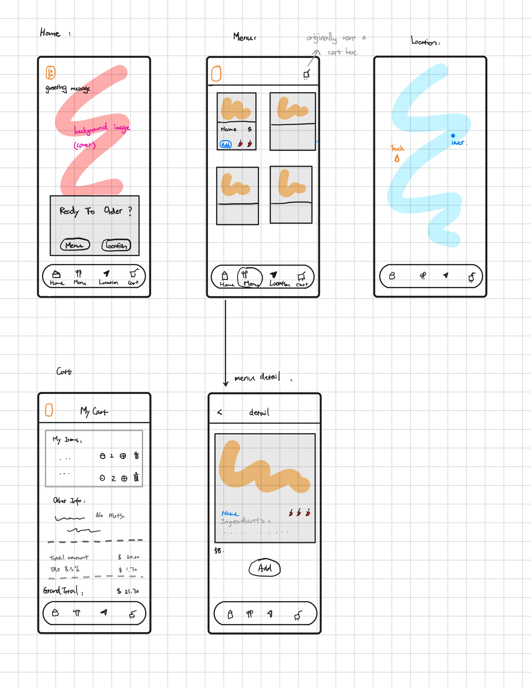

## App summary:

This is a food truck online menu brosing app. It includs:
wehlcome home view, 

- Menu, for brose the menu item.Click the picture, it will bring you to detail of this item.
- Detail: shows the ingreadiants for the current item, as well as a add button to add it into cart.
- Location(only ios for now): to check the current location for the foodtruck.
- Cart: shows the items has been added to the cart and a option of changing the quantity of the item and another option for delete the item.  
User can alos leave the notes here for special request to the chef, such as "no onion"

npx expo run:ios

Wireframe:


## Bottom navigation

`import { NativeTabs } from "expo-router/unstable-native-tabs";`
The bar at the bottom is a native tab bar. Each navigation button opens the screen file with the same name:

- Home opens `src/app/(tabs)/index.tsx`
- Menu opens `src/app/(tabs)/menu.tsx`
- Location opens `src/app/(tabs)/location.tsx`
- Cart opens `src/app/(tabs)/cart.tsx`

To change a label or icon, edit that button's `NativeTabs.Trigger` in `_layout.tsx`.  
`Trigger`: change what the user sees after tapping, edit the matching screen file.

## Location services (Mobile Device Functionality )

#### Show current location of the food truck on ios map.

The food truck location menuly set in location.tsx (so far, I set it at Utah Tech):

```bash
const truckLocation = {
  latitude: 37.104472,
  longitude: -113.565194,
};
```

For user location, when opening app, it will ask ithe permission of using the location. After selecting the option, useLocationPermissions() reads whether this app is allowed to use location, it returns the current status and `requestPermission()`.
The status is set to false to begin, useEffect calls `requestPermission()` once. if it is asked, it stops this effect of asking the permission on every render.

In DeviceHub, Device -> Location -> then pick a location, it will appear in a blue dot, which shows it is the user location, so the user can see how far from it to the food truck.

## Location Map 

Platform.OS = 'ios':  
package( expo-map ): `npx expo install expo-maps`

two other things to install so map could run on the iPhone:

- expo-build-properties: turns on the iOS scene lifecycle so the app is allowed to launch.
- CocoaPods: installed with Homebrew, compiles the native iOS code, including the map.

location.tsx:  
`import { AppleMaps } from "expo-maps";`


iOS will only show that permission ask dialog if the installed app contains a reason string, which is declared in `app.json` on the expo-maps plugin:

```bash
# # set to ture tells expo-map plugin to add location permission to the iOS app.
"expo-maps",
{
  "requestLocationPermission": true,  
  "locationPermission": "Allow Guate Wok to use your location to show you on the map next to the truck."
}
```


## Cart

### - Use AsyncStorage to save the Customer Order Notes.(Storing string value) wiht useEffect()

```bsah
npx expo install @react-native-async-storage/async-storage
```

`import AsyncStorage from "@react-native-async-storage/async-storage";`

in cart.tsx:

```bash
  return (
    <View style={styles.container}>
      <OrderNote note={note}
      onChangeNote={updateNote}/>     ->    changed from onChangeNote={setNote}
    </View>
  );
```

The {setNote} is where the customer notes changes, here is where i insert a updateNote function to do the change part. Inside the updateNote function, it calls the async function storeNoteData() which use setItem('key', value).

```bash
async function loadNote() {
  const saved = await AsyncStorage.getItem("orderNote");
  console.log("saved note:", saved);
  if (saved !== null) {
    setNote(saved);
  }
}
```

LoadNote() uses the getItem('key') with the key 'oederNote' to get the value out of the locoal storage where the note is saved. and store it in a variable 'saved'. then setnNote to it.

### - useEffect():

```bash
useEffect(() => {
  loadNote();
}, []);
```

loadNote(): "What to run"
[]: "When to run"

The '[]' means there is no changem so nothing to watch. When first time the Cart screen opens, React runs loadNote() once, and this is it. It wont do it on every letter user type, setNote() is the one taht does this. so put [] instead of setNote(), means the value is not in the watch list, then it wont trigger this effect. Typing stays on updateNote.

### - Add menu item into cart. useContext, AsyncStorage for cartItems to stay after reload app.

In the menu.tsx each dish is defined as a object in a list.

```bash
[{ id: "1", name: "Taco", image: require("../../../assets/images/taco.jpg") }],
```

id and name is what i want to display after added to cart.

here is the simple version ( without useState )of the how useContext used here, for easier understanding:

1. create context
2. wraps the component needed for use this context inside of the ContextProvider
3. export the context by making a function.

```bash

const CartContext = createContext({
  items: [{ id: "1", name: "Taco" }],
});

export default function CartProvider({ children }) {
  const items = [{ id: "1", name: "Taco" }];
  return (
    <CartContext.Provider value={{ items }}>
      {children}
    </CartContext.Provider>
  );
}
export function useCart() {
  return useContext(CartContext);
}
```

### - minus/plus counter button:

function increaseQuantity() / decreaseQuantity() are onplemented in `CartContext.tsx`.

 because that file owns the cart list. The plus and minus buttons only start the change. They do not change the number themselves. 
 In `CartCounter.tsx`, the component CartConter at the minus/plus icon, the onPress() is calling the function decrease/increaseQuantity()
 `cart.tsx` connects the buttons to the cart. It gets both functions from `useCart()`, then passes the item's id.

at the end of `cartContext.tsx` useCar() is exported, and it has a value of cartContext, at the `zcart.tsx` when need to use context, specifically the value in side the context, need to remember to add the value in useCart() :

```bash
const { items, decreaseQuantity, increaseQuantity, } = useCart();                      
```

//  this is the function a screen calls to get the cart.

### - delete item:

when clicking trashcan icon, for example, deleting the taco, when the loop sees the id of the taco is same as the taco i want to delete, then it wont call the `next.push(item)`, so the item nees to be deleted wont in next list. When return next, it willsend the 'next list' to setItems, now, the items wont have taco. this is how taco disapper from the screen.

### Component: CartCounter

This is a component taht shows minus/plus button for quantity of the items in cart.
It has the value of in/decrease functionnality and a quantity in between the 2 buttons.

## HIG

1. https://m3.material.io/foundations/designing/structure

Touch and pointer target sizes

```bash
  const styles = StyleSheet.create({          // touch target 
  logoButton: {
    width: 140,
    height: 48,
    justifyContent: "center",
  },
  logo: {
    width: 140,
    height: 40,
    backgroundColor: "transparent",
    marginLeft: -36,
  },
```

- In `m3.material.io`, it saying "For example, an icon may appear to be 24 x 24dp, but the padding surrounding it comprises the full 48 x 48dp touch target."

My truck icon is 40 x 140 so I made the target to be 140 x 48 without shink the icon.

2. https://m3.material.io/components/navigation-bar/overview

Navigation bar. 
"A phone app uses a bottom bar with 3 to 5 fixed destinations. Each one has an icon and a label."

My app has four: Home, Menu, Location, and Cart. Each trigger has an icon and a label in src/app/(tabs)/_layout.tsx.

3. https://m3.material.io/components/cards/specs

Cards. 
"A card groups one subject on its own surface. The spec uses 16dp of padding inside the card."

In src/app/(tabs)/cart.tsx, the cart list and the order note in white cards with padding.
In src/components/MenuCard.tsx, Each menu dish is its own card with padding 16.